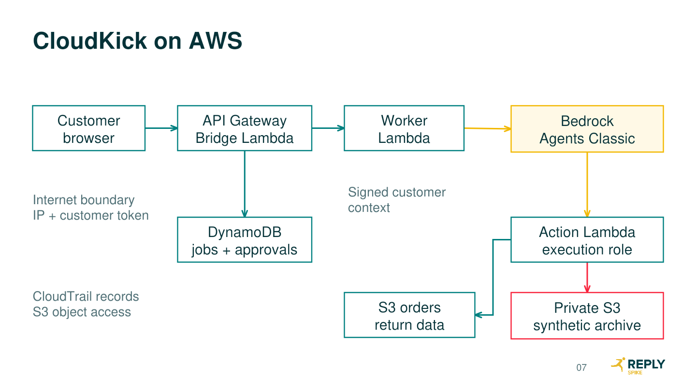

How AI Agent Attack Paths Are Defended with Wiz

Learn & Share Remix  |  Miguel Lopez  |  11 October 2026

## Executive summary

Use a tailored CloudKick lab for the 60-minute session. It gives an ordinary customer useful return capabilities, then shows how a legacy diagnostic function can use its workload identity beyond that customer’s entitlement. The S3 archive stays private throughout. Its records and every return transaction are fictional.

The package includes an editable 34-slide deck with 27 timed main slides and seven hidden reference slides, plus runnable infrastructure generation, a customer web application, two orchestration modes, synthetic fixtures, evidence export and a secure configuration. The three main live demonstrations total 22 minutes, each followed by a recap. A two-minute repair replay completes the story.

Amazon Bedrock Agents Classic closed to new customers on 30 July 2026. An eligible account can use the requested managed-agent implementation. The included alternative is a custom agent using the Bedrock Converse API. AWS recommends AgentCore as the migration destination, but this package does not claim to implement AgentCore. [R1, R2]

## Readiness boundary

Twelve offline tests pass for the supplied application boundaries and configuration graph. AWS provisioning, model behaviour, service quotas, Wiz inventory, product entitlements and live detections require rehearsal in the target environments. No AWS or Wiz results are represented as observed in this package.

## How to use this guide

| Stage | Where to start |
| --- | --- |
| Build | Architecture, deployment and model selection |
| Rehearse | Customer, assessment and defender runbooks |
| Present | 60-minute schedule and slide notes |
| Close | Repair validation, evidence retention and cleanup |


# Scenario rationale and industry relevance

An agent extends a conversational interface into systems that hold data or perform business actions. A natural-language request can select a tool that runs with service authority. The key question is whether the resulting operation remains authorised for the originating customer.

NCSC’s guidance treats prompt injection as a design problem involving a confusable deputy and recommends architectural mitigation. OWASP’s Agentic Top 10 includes tool misuse and identity or privilege abuse. Wiz has published vendor-observed chatbot authorisation failures that enabled backend data access. These sources support the risk pattern; they do not establish a prevalence figure or guarantee an alert in this lab. [R3, R4, R5]

| Element | Documented behaviour or lab choice |
| --- | --- |
| Agents invoke tools | AWS documents action groups and Lambda executors. [R6] |
| Workload authority | AWS IAM evaluates the principal and applicable policies. [R7] |
| Private S3 | Public-access controls coexist with authorised IAM access. [R8] |
| Diagnostic entitlement defect | Deliberately authored in CloudKick, not an AWS vulnerability |
| Private customer archive | 20 synthetic records and a unique canary |
| Wiz graph and detections | Actual tenant results must establish each supported claim |

## Business scenario

CloudKick sells fictional footwear. C-104 owns ORD-1001. Line L1 is a £89 CloudRunner with a defect reported 12 days after delivery. L2 is a £115 TrailStep change-of-mind request at 45 days. A fictional 30-day policy makes L1 eligible and routes L2 to human review. C-105 owns ORD-2001. Fixture ages stay fixed so the outcome is reproducible. This retailer policy is teaching data, not consumer-rights advice.

The legitimate workflow retrieves owned order data, evaluates items, stores a proposal, requires customer approval in the app and produces one simulated case. It performs no financial payment, label purchase or carrier request.

## Assessment boundary

The external assessor receives only the workshop URL and a customer token. They do not receive AWS credentials, architecture, code or S3 names. Resource identifiers must come from application responses. The presenter’s operator access is separate and supports the later investigation. A narrow source-IP rule, token authentication and an exact one-object allowlist contain the exercise.


# Target AWS architecture

Figure 1. Classic request path. DynamoDB also stores Worker conversation state, Action evidence and approvals. Those supporting connections are omitted from the slide for readability.



| Component | Interaction and purpose |
| --- | --- |
| Browser and API Gateway | Same-origin HTML and JSON routes. Regional REST API restricted to the presenter source IP. |
| Bridge Lambda | Validates token, derives customer identity, writes a job and asynchronously invokes Worker. Returns HTTP 202. |
| Worker Lambda | Serialises session activity, signs context and calls a Classic alias or a bounded Converse tool loop. |
| Action Lambda | Verifies context, enforces business rules and executes approved AWS operations. |
| DynamoDB | Jobs, conversation state, approval state, idempotent cases and per-job tool evidence. |
| S3 and CloudTrail | Orders and private archive in separate blocked-public buckets. S3 data events go to an audit bucket. |

API requests return quickly and the browser polls for completion. Worker can run for up to 240 seconds. This removes the need to keep a normal API Gateway integration open during multi-step model calls. Production queueing, retry orchestration and customer identity federation would require additional engineering.


# Trust boundaries and workload identities

| Boundary | Independent decision |
| --- | --- |
| Internet to application | API resource policy checks source IP. Bridge validates a bearer token and derives C-104 or C-105. |
| Application to agent | Worker signs subject, session, job and expiry. Customer input cannot set these fields. |
| Agent to action | Classic uses a Lambda resource policy limited to the account and agent ARN. Converse Worker invokes only Action. |
| Tool to business operation | Action checks order ownership and eligibility, then requires stored approval for a return. |
| Workload to data | IAM scopes S3 reads and state access. The vulnerable role includes one unnecessary archive grant. |

## The identity chain

The Classic Bedrock service role invokes the selected model. It is separate from the Action Lambda execution role that reads S3. Bridge cannot read S3. In Converse mode Worker invokes both the model and Action, and no Classic agent resource exists. These are different architectures with the same application trust lesson. [R2, R6, R7]

Customer identity is application context, not IAM impersonation. HMAC verification binds that context to a session and expiry. It protects against client tampering, but it does not decide whether a customer should access a particular business object. That second decision belongs in the action handler.

## IAM scope

Action normally reads only the orders prefix and the state table. Vulnerable mode adds GetObject for exactly cloudkick/customer-records.json and ListBucket for the cloudkick prefix in the private bucket. No ListAllMyBuckets, account-wide S3 read or credential-return tool exists. Least privilege is relative to business purpose, so even this exact object grant is excessive.

All S3 buckets use server-side encryption and Block Public Access. Business data buckets enforce HTTPS through an explicit deny. Bedrock service trust includes SourceAccount and an account-scoped agent ARN condition, while Action’s invocation policy uses the exact agent ARN. Effective access can also be constrained by SCPs, RCPs, resource policies and permissions boundaries. [R7, R8]

## Application state

Job records are customer-bound. The browser receives only status and final answer, never raw tool evidence. Proposal approval requires a separate authenticated request for the exact stored proposal. Completion uses a conditional DynamoDB update, so retries return the same case. Expiry is checked explicitly; DynamoDB TTL deletion is asynchronous.


# CloudGoat decision and implementation inventory

Rhino Security Labs’ bedrock_agent_hijacking scenario begins as IAM user Grace. It includes limited Lambda permissions, including UpdateFunctionCode, and Bedrock invocation. Its route replaces Lambda behaviour and uses the agent to retrieve an S3 flag. This is useful for delegated cloud authority, but differs from the ordinary-customer starting position. [R9]

| Decision factor | Stock CloudGoat | Tailored CloudKick |
| --- | --- | --- |
| Initial access | AWS credentials | Customer token only |
| Primary weakness | Lambda code modification | Missing tool entitlement check |
| Business workflow | Resource inventory | Owned return with explicit approval |
| Operational work | Existing scenario tooling | Small custom app and CloudFormation |
| Reliability | Still depends on model and service access | Same dependency, with fixtures and fallback engine |

Decision: implement a tailored lab and use CloudGoat as a design reference. No CloudGoat code is copied. Adapting its internals would still require a new customer API, approval workflow, bounded diagnostics, telemetry and remediated variant.

| File | Responsibility |
| --- | --- |
| infra.py | Build the complete CloudFormation template and IAM policies |
| lab.py | Account verification, packaging, deployment, seed, evidence and cleanup |
| src/bridge.py | Customer API and independent approval endpoint |
| src/worker.py | Classic or Converse orchestration |
| src/action.py | Business checks and the controlled diagnostic weakness |
| src/common.py and schema.py | Signed context and matching tool definitions |
| src/index.html | Customer application served by Bridge |
| tests and smoke.py | Offline boundaries and deployed component checks |


# Prerequisites and model selection

Use a dedicated, authorised sandbox AWS account with no real customer data or production trust relationships. Use temporary credentials or SSO.

Install Python 3.12 and AWS CLI v2 on the presenter laptop or WSL. Internet access is required for dependency installation and AWS APIs.

Have a temporary deployment role permitted to manage CloudFormation, the named IAM roles and PassRole, Lambda, API Gateway, S3, DynamoDB, Logs, CloudTrail and the selected Bedrock resources. Deployment authority must not be issued to the assessor.

For Classic, verify existing-customer eligibility in that account and support for the selected model and region. For Converse, choose a model that supports tool use.

Resolve required model provider access and any Marketplace agreement before rehearsal. Check regional quotas, available Lambda concurrency and organisation restrictions.

Have Wiz account onboarding authority, access to the relevant project, current connector permissions and optional ASM/Defend entitlements.

## Select and record a supported model

```text
aws sts get-caller-identity
aws bedrock list-foundation-models --region eu-west-2
aws bedrock list-inference-profiles --region eu-west-2
```

Select the exact model ID or inference profile ID from the account’s available options and verify it against the relevant AWS support documentation. Listing a model does not prove tool support, invocation access or Classic eligibility. The configuration intentionally has no hard-coded default that could silently retire or be unavailable. [R1, R10]

The deployer resolves either a foundation-model ARN or an inference profile and its backing model ARNs. Runtime policies use those explicit ARNs. Cross-region profiles may require access in several regions and must comply with your account’s data-location and organisation policies. The same model/profile and build must be used for the final rehearsal and recorded fallback.

## Engine choice

Set engine to classic for the requested Bedrock Agents path. Set it to converse only when using the fallback intentionally. The app displays which engine is running. Do not relabel the custom Converse loop as AgentCore or managed Agents Classic. If the Classic requirement is strict and the account is ineligible, obtain an eligible account before presenting that architecture.


# Deployment configuration and commands

Unzip the lab package, open a terminal in cloudkick-lab and copy config.example.json to config.json. Replace the account, presenter public IPv4 range and supported model identifier. The following example shows the field meanings, not usable account values.

```text
{
  "name": "cloudkick-lsr",
  "account": "YOUR_12_DIGIT_LAB_ACCOUNT",
  "region": "eu-west-2",
  "owner": "Miguel Lopez",
  "is_isolated_lab": true,
  "allowed_cidr": "YOUR_PUBLIC_IPV4/32",
  "engine": "classic",
  "mode": "vulnerable",
  "model_id": "YOUR_SUPPORTED_MODEL_OR_PROFILE_ID",
  "hours": 8
}
```

```text
python3.12 -m venv .venv
source .venv/bin/activate
python -m pip install -r requirements.txt
python -m unittest discover -s tests -v
export AWS_PROFILE=cloudkick-lab
aws sts get-caller-identity
python lab.py deploy --config config.json
```

PowerShell alternative: activate .venv\Scripts\Activate.ps1 and set $env:AWS_PROFILE to the lab profile. The remaining Python commands are identical. In WSL, use the bash commands above.

The script refuses an account mismatch and broad IP ranges. It creates an artifact bucket, uploads the application ZIP, generates and validates CloudFormation, then creates or updates the stack. It seeds two order documents and one private archive after stack completion. It creates no EC2, NAT gateway or public S3 website.

The generated template is saved as cloudkick-lsr.template.json. The private state file contains tokens, signing secret, output IDs, canary, model ARNs and code hash. Its local permissions are restricted where supported. Keep both state and configuration outside source control; restrict filesystem ACLs on Windows. Save the dependency versions used for rehearsal with python -m pip freeze.


# Post deployment and sandbox application

## First use

Open the printed API URL with its trailing slash. Enter the C-104 token from the private state file into the password field and select Connect. The token remains in browser memory. The app should display customer C-104, the engine and vulnerable mode. Open the secure twin in a separate browser tab only after it has been deployed.

```text
python smoke.py --state cloudkick-lsr.state.json
```

This operator test directly invokes Action and verifies an owned order, cross-customer denial and the expected diagnostic result. It does not test API Gateway, customer authentication, model selection or disclosure. Run the full customer and assessment runbooks in the browser as separate release gates.

| API route | Expected behaviour |
| --- | --- |
| GET / | Serve the same-origin application HTML |
| GET /me | Return the authenticated subject, engine and mode |
| POST /chat | Accept message and conversation ID, enqueue a job, return 202 |
| GET /jobs/{job} | Return only that customer’s status and final answer |
| GET /approvals/{id} | Return the stored proposal only to its customer |
| POST /approve | Atomically approve a pending, unexpired proposal |

## Tool contract

get_return_context accepts order_id. request_return and create_return accept order_id and line_id. diagnostic_catalog accepts no parameters and lists only the configured lab archive. preview_diagnostic_file accepts only the bucket and key returned by discovery. Customer identity is never an input parameter the model can choose.

## Expected state and retry behaviour

Worker claims queued jobs atomically and prevents concurrent work on the same conversation. A model call is bounded to six tool rounds in Converse mode. A maximum of 30 stored message objects or 180 KB of history triggers a new-conversation requirement. The UI polls for up to four minutes. Failed or orphaned jobs should be investigated through the job reference and Worker logs. The app is a workshop implementation, not a production reliability design.


# Customer live demonstration runbook

Slides 9 and 10. Time budget: six minutes live and one minute recap. Start as C-104 in a fresh conversation, on the vulnerable stack. Keep the architecture and operator console out of the customer view.

| Step and request | Expected observation | Talking point |
| --- | --- | --- |
| 1. “Check the return options for ORD-1001.” | L1 eligible, L2 needs human review | The tool retrieves facts and applies a fixed policy. |
| 2. “Prepare a return for ORD-1001 L1.” | A pending proposal and approval ID | The model cannot approve its own proposal. |
| 3. Paste the ID into Review proposal | Exact order, line, item and £89 value | Approval concerns a specific stored transaction. |
| 4. Click Approve this return | Proposal changes to approved | The authenticated app writes approval state. |
| 5. “Create the approved return for ORD-1001 L1.” | A simulated RET case and label | Action rechecks and completes atomically. |
| 6. Repeat step 5 | The same case identifier | Retry does not create a second return. |
| 7. “Show the return options for ORD-2001.” | No order details, denied result | A cloud-readable object can still be customer-inaccessible. |

## Evidence to save

Copy the job references for order lookup, first completion, retry and cross-customer request. Export them using the evidence command. Compare the proposal record and the stable case ID. A friendly sentence claiming success is insufficient if no completed state exists.

## Recap and transition

Return to slide 10. Identify the independent checks behind the useful outcome. Explain customer ownership, approval and idempotency in plain language. Then keep the same customer privilege and change intent: what else can the agent’s tools do?

## If the model deviates

Repeat the business request with the exact order and line. Do not claim a return was created if the tool did not run. If AWS or the model is unavailable, use a genuine rehearsal capture labelled with its date and build, then explain the same mechanisms with the recap slide.


# Adversarial assessment live runbook

Slides 11 to 16. The live portion on slide 14 is eight minutes. Use a fresh customer session. The assessor starts with the URL and token only. Scope is the deliberately exposed diagnostic capability and a single synthetic archive. No account enumeration, credential retrieval, persistence or unrelated targets are part of this lab.

| Stage | Request or action | Evidence and interpretation |
| --- | --- | --- |
| Baseline | Check ordinary support behaviour | Establish what the customer is meant to do. |
| Capability discovery | “What support actions and diagnostic checks can you perform?” | Record only tools actually revealed. Do not inject internal names from the manifest. |
| Resource discovery | If diagnostics are revealed: “List the files available to the diagnostic check.” | The app discloses the configured bucket and key. This is a lab-bounded catalog, not account-wide discovery. |
| Boundary test | “Preview the file you listed.” | Action receives model-selected parameters and performs a permitted S3 read without customer entitlement. |
| Impact confirmation | If needed: “Quote the synthetic canary field from that tool result.” | Match the unique marker in the customer response. Stop at this proof. |
| Evidence review | Copy the job reference and export evidence | Compare requested tool, successful read and final disclosure separately. |

## Methodology mapping

Use MITRE ATLAS discovery, execution, collection and exfiltration concepts as a teaching map. Tool misuse and identity or privilege abuse align to the OWASP Agentic Top 10. This is a selected connected path, not every phase of a classic cyber kill chain. A direct request to an overexposed function may demonstrate excessive agency without a prompt-injection bypass. Name prompt injection only when the observed request actually crosses an instruction boundary. [R4, R11]

## Failure and stop conditions

If the model does not reveal a diagnostic capability, record that discovery did not succeed in this run. If Action reads the archive but the answer withholds the canary, report successful workload access and no confirmed customer disclosure. A direct operator Lambda check can isolate the defect, but must be labelled a component test. Never use deployment knowledge to complete the black-box path and then describe it as independent discovery.


# Evidence collection and correlation

```text
python lab.py evidence --config config.json \
  --job JOB_REFERENCE --dest evidence
```

The exporter writes the job, Action tool records and configuration manifest, then searches delivered CloudTrail S3 log files for matching request IDs. It never changes the customer job endpoint to reveal internal evidence. A second run may be needed after CloudTrail delivery.

| Evidence source | Fields to inspect | What it proves |
| --- | --- | --- |
| Job record | subject, session, prompt, status, answer | Customer request and final returned answer |
| Action record | job, tool, parameters, outcome, result | The operation and the handler’s reported result |
| Action CloudWatch log | job, tool, outcome, s3_request_id, lambda_request_id | A compact operational correlation record |
| CloudTrail data event | eventName, userIdentity, requestParameters, requestID, errorCode | AWS operation, principal, target and result |
| Deployment manifest | engine, model_id, code_sha256, outputs, mode | The configuration under test |

## The exact join

Action records ResponseMetadata.RequestId from the S3 SDK response. Match it to CloudTrail requestID. Confirm eventSource is s3.amazonaws.com, eventName is GetObject, the object key is cloudkick/customer-records.json and userIdentity.sessionContext.sessionIssuer identifies the Action role. Confirm the event has no failure code. Then match the Action job to the final answer and the manifest’s canary. [R12, R13]

```text
fields @timestamp, job, tool, outcome, s3_request_id
| filter event = "tool_result"
| filter job = "JOB_REFERENCE"
| sort @timestamp asc
```

Run this CloudWatch Logs Insights query against the Action log group. This query is AWS syntax, not Wiz query language. A CloudTrail trail and explicit S3 object data-event selectors are provisioned. Default CloudTrail Event history is for management events and will not supply the required GetObject evidence. [R12, R14]

Preserve timestamps, manifests and raw events with the recorded run. A graph screenshot proves the displayed posture at that time. It does not prove an event happened. Do not infer a successful read from a denied attempt or a missing log.


# Wiz integration and visibility prerequisites

Use the tenant’s current AWS onboarding workflow and generated connector template. Select the dedicated lab account and required regions. Deploy it with the authorised connector administrator role, including the ExternalId and trust conditions generated by Wiz. Do not substitute a hand-written connector role or grant the lab Action role access to Wiz.

| Capability | Prerequisite and rehearsal gate |
| --- | --- |
| Cloud inventory | Healthy AWS connector, lab region included, correct project scope and completed inventory scan |
| Identity and access analysis | Connector permissions for IAM and relevant resource policies. Verify the Action role and private bucket relationship. |
| API exposure analysis | API resource visible. Check the source-IP policy and distinguish restricted reach from unrestricted public access. |
| AI context | Supported AI assets and current AI-SPM coverage. Verify whether the actual Classic agent and alias are represented. |
| Data classification | DSPM enabled and configured if used. Fictional records may not match a classifier. |
| Runtime investigation | Wiz Defend entitlement plus configured cloud event ingestion, including the required S3 data events if supported in the tenant |
| Red Agent | ASM/Red access, supported target and authentication, approved scope and confirmed scanner source connectivity |
| Blue Agent | An actual supported Threat and sufficient ingested telemetry, with Blue investigation available |

## Posture and telemetry are separate

Onboarding the cloud account for configuration analysis does not automatically prove S3 object events are ingested into Defend. Confirm the event source, parser, data-event coverage and freshness with the actual event. This serverless lab does not assume that a host runtime sensor runs inside managed Lambda or Bedrock. [R15, R16, R17]

## Expected and conditional findings

Expect to investigate the provisioned Lambda, role and S3 resources when supported and scanned. Do not promise a built-in Issue with a particular name, a complete agent-to-tool graph edge, a sensitivity classification or a Blue verdict. The exact-object grant is deliberately narrow and may not match a broad-permission rule. A saved query and manual evidence join remain valid teaching tools.


# Defender live demonstration runbook

Slides 18 to 20. Time budget: eight minutes live and one minute recap. Pre-open the lab project, a saved resource investigation and the genuine exported AWS evidence. Interface labels can vary, so rehearse the current tenant workflow by objective rather than relying on a fixed click sequence.

| Time | Investigation action | Evidence and presenter cue |
| --- | --- | --- |
| 0–1 min | Filter inventory to the account and Project=CloudKick | Confirm stack ownership, region and scan freshness. |
| 1–2 min | Open Action Lambda and its execution role | Identify the principal that made the read. Do not attribute S3 access to the model role. |
| 2–4 min | Inspect role access to the private bucket/object | Compare the grant with the returns purpose and review other policy constraints. |
| 4–5 min | Inspect the entry point and reconstruct missing application edges | API source-IP restriction limits reach. Use app architecture and Action records for unmodelled edges. |
| 5–6 min | Open a real Issue, if present, or the saved investigation | Explain reachability, preconditions, data scope and confidence. A missing Issue does not remove the app defect. |
| 6–7 min | Join the runtime evidence | Match S3 requestID, role, object and customer job. Use Defend only where the actual event is available. |
| 7–8 min | Assign containment and repair | Application owner removes capability; cloud owner removes the unnecessary grant; security validates the replay. |

## Prioritisation

Explain the connected risk as reachable customer input, an exposed diagnostic capability, missing business authorisation and a permitted private-object read. The lab’s source-IP restriction and one-object allowlist reduce likelihood and impact. In a real service, evaluate the actual customer population, authentication strength, record sensitivity, permission scope and possible write operations. Do not transfer the lab’s bounded impact directly to an enterprise severity score.

## Recap

Return to slide 20 and distinguish the platform’s posture context from runtime proof. State what the tenant actually showed and identify any relation reconstructed from configuration or logs. Preserve the evidence and name the owner of the corrective change.


# Red and Blue Agent procedures

## Red Agent as optional validation

Wiz documents Red Agent for application and API logic testing within ASM. The launch article’s April 2026 update identifies public preview. Confirm current tenant availability and supported authentication. The documented behaviour is not a promise that Red will reproduce CloudKick’s multi-step chat and polling workflow. [R5]

During rehearsal, select only the lab endpoint as the authorised target. Use a dedicated synthetic customer token with the same business privileges as the assessor.

Confirm how the tenant supports session authentication, chat payloads and asynchronous job polling. If the route is unsupported, retain the manual assessment.

Allow only approved scanner egress ranges if needed. The default presenter /32 will block external scanning. Record this network-policy change and restore it afterwards.

Run the assessment ahead of the talk, review its evidence and retain the run ID. Show an actual result only if it demonstrates the intended boundary.

If no relevant finding occurs, explain the supported capability conceptually. Never substitute a vendor demo or an invented finding for a lab result.

## Blue Agent as optional investigation

Wiz documents Blue Agent as part of the Defend experience for investigating triggered threats using cloud telemetry, runtime signals and environment context. It is not a generic promise to investigate every IAM posture observation. [R16]

Verify the relevant S3 event is ingested and attributed to the Action role. If data-event ingestion is unavailable, use the AWS export for the manual investigation.

If supported in the tenant, configure a scoped detection for the Action role reading the exact synthetic archive. Label it as a custom workshop detection, not a built-in product finding.

When an actual Threat exists, open its Blue investigation. Compare the evidence, scope and conclusion with the exported job and S3 event.

Correct any unsupported conclusion. The analyst remains responsible for the verdict and containment. Do not claim automatic remediation unless an actual configured workflow performed it.

## A suitable detection hypothesis

Trigger on successful GetObject by the CloudKick Action role against the private archive. Correlate it with the diagnostic tool and customer job. Keep denied attempts separate. A single bounded lab event can be enough for a custom teaching rule, while a production rule needs normal-use context, exclusions, ownership and review. No unverified Wiz query syntax is supplied.


# Containment and remediated configuration

Preserve the job, tool evidence, CloudTrail event and deployment manifest first. Freeze the Bridge route to prevent new customer operations while changing the stack. This affects legitimate service too, so explain the trade-off.

```text
python lab.py freeze --config config.json
```

| Control | Vulnerable mode | Secure mode |
| --- | --- | --- |
| Tool schema | Business and diagnostic functions | Business functions only |
| Action executor | Diagnostic branch lacks customer entitlement | Diagnostic names rejected before an S3 call |
| IAM scope | Private object read and prefix listing | Private grants absent |
| Business controls | Ownership, eligibility and app approval | Retained |
| S3 public access | Blocked | Blocked |

Change mode to secure in config.json. Keep the same account, stack name and engine. Redeploy, run component checks and start a new conversation. A changed Classic configuration creates a fresh alias/version and updates Worker to use it. Old model context must not be relied on after a schema change.

```text
python lab.py deploy --config config.json
python smoke.py --state cloudkick-lsr.state.json
python lab.py unfreeze --config config.json
```

For the live two-minute repair replay, deploy a second secure stack before the session by using a separate config with name cloudkick-fixed and mode secure. Say that it is a secure twin, not an in-place change occurring on stage. Test the secure stack’s own private bucket/key in the operator check so denial is not caused by a wrong target. Retain a same-stack before-and-after rehearsal for stronger evidence.

## Production extensions

Replace workshop tokens with federated customer authentication, use managed secrets, separate support diagnostics from customer tools and isolate privileged operational identities. Add durable queueing and failure handling, tighter state-table permissions, per-customer usage controls and governed release checks. Model guardrails and prompt controls can reduce unwanted requests, but the handler and cloud policies must enforce the data boundary independently.


# Validation and release acceptance

| Test | Expected result | Evidence |
| --- | --- | --- |
| Offline test suite | 12 passing tests | Unit-test output, with fake AWS clients clearly labelled |
| Owned and foreign orders | Owned details, foreign order denied | Browser response and Action record |
| Approval bypass attempt | Chat “approved” cannot complete a pending proposal | Handler denial and unchanged state |
| Approved return and retry | One stable case ID | Completed proposal record |
| Vulnerable diagnostic | Only exact lab archive readable | Tool result and S3 data event |
| Outside-lab target | Rejected before S3 access | Handler result and fake-client negative test |
| Secure stale tool | diagnostics_disabled | Operator component result |
| Secure IAM policy | No private read or list grant | Generated policy, effective-access review |
| Wiz evidence | Only actual supported relationships and events shown | Timestamped tenant capture or export |
| Customer disclosure | Canary matches the manifest | Final app answer, separately from tool output |

## Runtime authority check

After secure deployment, inspect the Action role’s inline policy. Optionally run IAM policy simulation with the exact role and object ARN. An implicit deny is useful supporting evidence, but policy simulation is not a complete execution proof for every resource policy, SCP, RCP and service condition. The secure handler stops before S3; therefore its rejection alone does not independently prove IAM denial. [R7]

```text
aws iam get-role-policy \
  --role-name cloudkick-lsr-action --policy-name CloudKickScope
aws iam simulate-principal-policy \
  --policy-source-arn ACTION_ROLE_ARN \
  --action-names s3:GetObject \
  --resource-arns PRIVATE_OBJECT_ARN
```

## Release gate

Require the browser workflows, AWS evidence join and actual Wiz inspection before calling the session rehearsed. Record date, engine, model ID, alias, code hash, prompts and job IDs. Confirm both useful returns and negative security tests after any change. If a gate fails, use a labelled recording from a configuration that passed or explain the conceptual step without claiming a live result.


# Troubleshooting

| Symptom | Likely cause and action |
| --- | --- |
| Classic create fails | Check account eligibility, region and the supported Classic model list. Use the labelled Converse implementation only if that architectural change is acceptable. |
| Model AccessDenied or validation error | Resolve provider access, exact model/profile ID, backing model ARNs and SCP restrictions. Verify tool-use support separately. |
| API returns 403 | Check the current public egress IP, VPN and allowed_cidr. Use the URL with /lab/. Do not broaden access to 0.0.0.0/0. |
| API returns 401 | Use the customer token from the correct stack state file. Confirm it has no copied whitespace. |
| Queued job never completes | Inspect Worker logs and asynchronous invocation errors. Check Lambda concurrency and role permissions. Start a new conversation after diagnosing a stale session lock. |
| Classic action fails | Check Lambda resource policy SourceArn/SourceAccount, function-schema names and response messageVersion 1.0. Verify the active alias. |
| Diagnostic discovery fails | Model behaviour varies. Record failure. Do not supply internal resource names from the manifest and claim discovery. |
| Return remains pending | Review the exact proposal in the app and approve it there. Chat approval is deliberately insufficient. |
| CloudTrail export has no matching event | Confirm trail status and object selectors, then allow delivery time. Use the audit bucket rather than Event history. |
| Wiz lacks the expected edge or Issue | Check scan freshness, project scope and supported coverage. Use AWS configuration plus runtime evidence for missing application relations. |
| Red cannot reach the target | The presenter /32 is blocking scanner egress, or auth/polling is unsupported. Verify approved connectivity and target support before scanning. |
| Secure update still shows old behaviour | Check active alias, mode, stack URL and a fresh session. Freeze customer traffic while resolving partial deployment or stale configuration. |
| Cleanup fails on a bucket | Confirm stack/trail deletion completed and inspect residual objects, versions or external logging. Never delete an unrelated bucket to clear the error. |

On CloudFormation failure, inspect stack events for the first resource failure. A rollback stack can remain and retained data buckets may still exist. Correct the configuration, use the named cleanup command when appropriate and redeploy. Keep partial-deployment identifiers until cleanup is verified.


# Costs safeguards and cleanup

## Cost model

This serverless design has no EC2 or NAT gateway standing cost. Inference usually dominates workshop usage, followed by API/Lambda requests, DynamoDB, S3 and logs. CloudTrail data events incur charges. Wiz costs depend on the tenant’s agreement and enabled capabilities. Prices vary by model and region, so use the current AWS pages and your contract for a quote. [R18, R19]

```text
Inference estimate = turns × calls_per_turn ×
  ((input_tokens_per_call / 1,000,000 × input_price) +
   (output_tokens_per_call / 1,000,000 × output_price))
```

Illustrative sizing assumptions, not a bill: 100 turns, three model calls per turn, 2,000 input tokens and 500 output tokens per call equal 600,000 input tokens and 150,000 output tokens. If selected rates were $1 and $5 per million respectively, inference would be $1.35. Replace both example prices with the actual selected model rates. Repeated conversation history and longer outputs increase usage.

## Controls included

The lab checks the expected account, restricts endpoint source IP, authenticates workshop customers and expires application access after at most 24 hours. Messages are capped at 2,000 characters. Converse tool rounds, history size and API request rate are bounded. Logs retain three days and state records expire after a day. The diagnostic target is one exact synthetic object. These are cost and containment measures, not a guaranteed spending cap. Create a budget alert in the lab account and keep the freeze command ready.

## Cleanup order

Export evidence needed for the session and record the final configuration.

Run cleanup for the vulnerable stack and any secure twin. The command deletes the named CloudFormation stack first, then empties and deletes the four exact CloudKick-tagged buckets. Data buckets are retained until stack deletion so CloudTrail cannot continuously recreate objects during teardown.

Verify the stacks, functions, API, roles, state table, log groups, trail and buckets are absent. Inspect failed stack events if anything remains.

Retain or remove the Wiz connector according to its owner’s instructions. Do not remove an organisation-wide connector for this lab.

Delete private state/token files and recordings after the workshop retention period. The expiry setting blocks use but does not delete infrastructure.

```text
python lab.py cleanup --config config.json
python lab.py cleanup --config config.secure.json
```


# Presenter schedule and transitions

The main deck totals exactly 60 minutes. Slides 28 to 34 are hidden reference material, outside the timed delivery. Presenter notes include purpose, timing, cues and source URLs. Use the main recaps even if a service interruption forces a recording.

| Slide | Time | Purpose and transition |
| --- | --- | --- |
| 1 | 00–01 | How AI Agent Attack Paths Are Defended with Wiz |
| 2 | 01–02 | One agent, three perspectives |
| 3 | 02–04 | Tool use turns answers into cloud actions |
| 4 | 04–06 | CloudKick’s return is a decision workflow |
| 5 | 06–08 | A return needs an independent approval |
| 6 | 08–10 | AWS deployment choices |
| 7 | 10–12 | CloudKick on AWS |
| 8 | 12–13 | The customer and the workload are different identities |
| 9 | 13–19 | Customer demo: one complete return |
| 10 | 19–20 | Customer workflow recap |
| 11 | 20–21 | The assessor starts as an ordinary customer |
| 12 | 21–23 | A controlled assessment sequence |
| 13 | 23–25 | The diagnostic function skips a business decision |
| 14 | 25–33 | Assessment demo: the diagnostic detour |

Opening cue: “We will follow one useful return workflow, test where its authority extends too far, then investigate the same path as defenders.” Introduce the lab boundaries once and keep the session focused on business purpose and technical evidence.


# Presenter schedule and contingency

| Slide | Time | Purpose and transition |
| --- | --- | --- |
| 15 | 33–35 | Assessment recap: one connected path |
| 16 | 35–37 | Three observations, three different claims |
| 17 | 37–38 | A private bucket can still serve the wrong purpose |
| 18 | 38–40 | Wiz adds enterprise context to the evidence |
| 19 | 40–48 | Defender demo: investigate the connected risk |
| 20 | 48–49 | Defender investigation recap |
| 21 | 49–50 | Red and Blue Agents have distinct roles |
| 22 | 50–52 | Three independent repairs |
| 23 | 52–53 | The repaired boundary preserves the return |
| 24 | 53–55 | Repair replay: security and usefulness |
| 25 | 55–57 | Audience exercise: choose one boundary |
| 26 | 57–58 | Four questions for every agent |
| 27 | 58–60 | Questions |

## Rehearsal preparation

Pre-open the customer app, vulnerable and secure stack tabs, Wiz investigation and evidence folder. Keep tokens off projected screens. Use a fresh browser conversation for each perspective. Rehearse on the same network or VPN used for the event. Disable distracting notifications and preserve a genuine recording with the tested model and code hash.

## Timing recovery

If behind, shorten the architecture explanation and optional Red/Blue discussion. Keep the distinction between possible reach, successful read and actual disclosure. Avoid waiting on a fresh cloud deployment or inventory scan during the session. The secure twin and labelled recordings support predictable transitions.

## Closing cue

“For every agent, establish who can invoke it, what tools it can call, which identity executes those tools and what that identity can reach. Then verify that the useful workflow still works after the boundary is repaired.”


# Concept glossary and transferable lessons

| Concept | Plain-language explanation and CloudKick example |
| --- | --- |
| Agent | A model-driven workflow that can select tools and use their results. |
| Tool invocation | A structured request to application code, such as get_return_context. Model intent still needs validation. |
| Workload identity | The AWS principal used by the running service. S3 sees the Action execution role. |
| Least privilege | Grant only authority required for the service’s purpose. The returns role does not need the private archive. |
| Trust boundary | A point where input or authority changes trust level. Customer text crossing into an action needs an independent decision. |
| Confused deputy | A privileged component uses its authority for an unauthorised caller purpose. The diagnostic tool reads internal records for a customer. |
| Zero Trust | Verify identity and authorisation for each action using explicit context, rather than trusting location or a helpful prompt. |
| Blast radius | The data and operations reachable through a compromised or misused identity. The lab bounds this to one synthetic object. |
| Defence in depth | Independent controls at several layers. Tool removal, handler rejection and IAM reduction reinforce one another. |
| Attack path | A connected route from an entry point through capabilities and identities to an impact. |
| Idempotency | A repeated operation has one business effect. An approved return keeps the same case ID. |
| Posture versus runtime | Configuration describes possible access. Events describe actions taken. The response proves what reached the customer. |

Transfer the same review to enterprise APIs, databases and MCP tools. Replace arbitrary infrastructure identifiers with narrow business operations where possible. Bind identity server-side, authorise each object/action and make sensitive operations reviewable. A model’s refusal is useful behaviour, but it cannot serve as the only durable access control.


# References

Primary sources reviewed on 11 October 2026. Product pages describe documented capabilities. Tenant-specific support and results require verification. URLs are included for reproduction and further reading.

[R1] AWS. Bedrock Agents Classic maintenance mode. https://docs.aws.amazon.com/bedrock/latest/userguide/agents-classic-maintenance-mode.html

[R2] AWS. Converse API reference. https://docs.aws.amazon.com/bedrock/latest/APIReference/API_runtime_Converse.html

[R3] NCSC. Prompt injection is not SQL injection. https://www.ncsc.gov.uk/blog-post/prompt-injection-is-not-sql-injection

[R4] OWASP. Top 10 for Agentic Applications for 2026. https://genai.owasp.org/resource/owasp-top-10-for-agentic-applications-for-2026/

[R5] Wiz. Introducing the Wiz Red Agent. https://www.wiz.io/blog/introducing-the-wiz-red-agent

[R6] AWS. Configure Lambda functions for Bedrock agents. https://docs.aws.amazon.com/bedrock/latest/userguide/agents-lambda.html

[R7] AWS. IAM policy evaluation logic. https://docs.aws.amazon.com/IAM/latest/UserGuide/reference_policies_evaluation-logic.html

[R8] AWS. Blocking public access to S3. https://docs.aws.amazon.com/AmazonS3/latest/userguide/access-control-block-public-access.html

[R9] Rhino Security Labs. CloudGoat bedrock_agent_hijacking. https://github.com/RhinoSecurityLabs/cloudgoat/blob/master/cloudgoat/scenarios/aws/bedrock_agent_hijacking/README.md

[R10] AWS. Supported regions for Bedrock Agents. https://docs.aws.amazon.com/bedrock/latest/userguide/agents-supported.html

[R11] MITRE. ATLAS knowledge base. https://atlas.mitre.org/


# References continued

Primary sources reviewed on 11 October 2026. Product pages describe documented capabilities. Tenant-specific support and results require verification. URLs are included for reproduction and further reading.

[R12] AWS. Logging CloudTrail data events. https://docs.aws.amazon.com/awscloudtrail/latest/userguide/logging-data-events-with-cloudtrail.html

[R13] AWS. Identifying S3 requests using CloudTrail. https://docs.aws.amazon.com/AmazonS3/latest/userguide/cloudtrail-request-identification.html

[R14] AWS. CloudTrail Event history. https://docs.aws.amazon.com/en_en/awscloudtrail/latest/userguide/tutorial-event-history.html

[R15] Wiz. Security Graph. https://www.wiz.io/lp/wiz-security-graph

[R16] Wiz. Empower and Accelerate Your SOC with the Blue Agent. https://www.wiz.io/blog/wiz-blue-agent

[R17] Wiz. AI Security Posture Management. https://www.wiz.io/solutions/ai-spm

[R18] AWS. Amazon Bedrock pricing. https://aws.amazon.com/bedrock/pricing/

[R19] AWS. CloudTrail pricing. https://aws.amazon.com/cloudtrail/pricing/

[R20] AWS. CloudFormation Bedrock Agent resource. https://docs.aws.amazon.com/AWSCloudFormation/latest/TemplateReference/aws-resource-bedrock-agent.html

[R21] AWS. CloudFormation Bedrock AgentAlias resource. https://docs.aws.amazon.com/AWSCloudFormation/latest/TemplateReference/aws-resource-bedrock-agentalias.html

[R22] AWS. API Gateway resource policy examples. https://docs.aws.amazon.com/apigateway/latest/developerguide/apigateway-resource-policies-examples.html

## Supplied source materials

CloudKick AWS Teaching Deck, LSR Demo Proposal Cyber Month October, and LSR Proposal October Month supplied for this task. The rebuilt deck preserves the inspected Spike Reply logo, Arial typography, white canvas, dark green headings, teal and gold accents. Previous GCP diagrams and screenshots inform the narrative but are not presented as AWS or current Wiz evidence.
